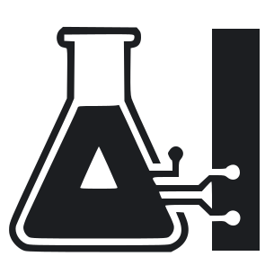

# Falken's Lab

**The home page of Falken's Lab: the door to the lab's most interesting projects.** 
Agents, MCP servers and libraries, many of them for teaching and Moodle.

**[🌐 falkenslab.github.io](https://falkenslab.github.io/)** · [🌐 En español](https://falkenslab.github.io/?lang=es)

This repository holds the organization's landing page: a static site in English and Spanish, with a light and a dark theme, that shows each featured project as a card linking to its own site and its repository. It follows the family's look shared by every Falken's Lab site (Inter and JetBrains Mono, the coral accent, the sticky top bar and the hero).

## 🗂️ What's inside

| Path | For |
| --- | --- |
| 📄 `site/index.html` | The page: top bar, hero, what the lab does, the projects and the footer |
| 🧠 `site/site.js` | The texts in both languages (`TEXTS`), the featured projects (`PROJECTS`), the smaller ones (`MORE`), the theme and language switches |
| 🎨 `site/site.css` | The family's tokens and components, light and dark |
| 🖼️ `site/img/` | The lab's mark and each project's logo (with its dark variant when it has one) |
| 🚀 `.github/workflows/pages.yml` | Publishes `site/` to GitHub Pages on every push to `main` |

## ➕ Adding a project

Copy its logo to `site/img/<name>.svg` (and `<name>-dark.svg` if it has one), add an entry to `PROJECTS` in `site/site.js` with its kind, its description in English and Spanish, its categories and its tags, and push: the card links to `https://falkenslab.github.io/<name>/` and to its repository. A smaller repository goes in `MORE` instead.

## 🛠️ Developing

There is nothing to build: open `site/index.html` in a browser, or serve the folder (`npx serve site`) and check both languages (`?lang=en`, `?lang=es`), both themes and a phone's width before pushing.

Made with 💖 by Falken's Lab Team

